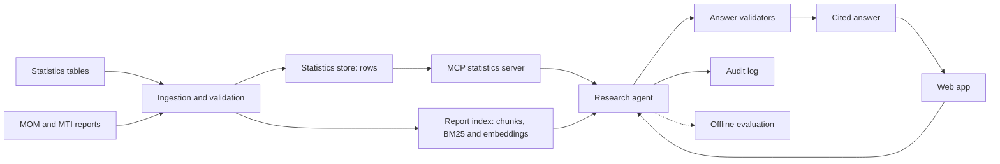
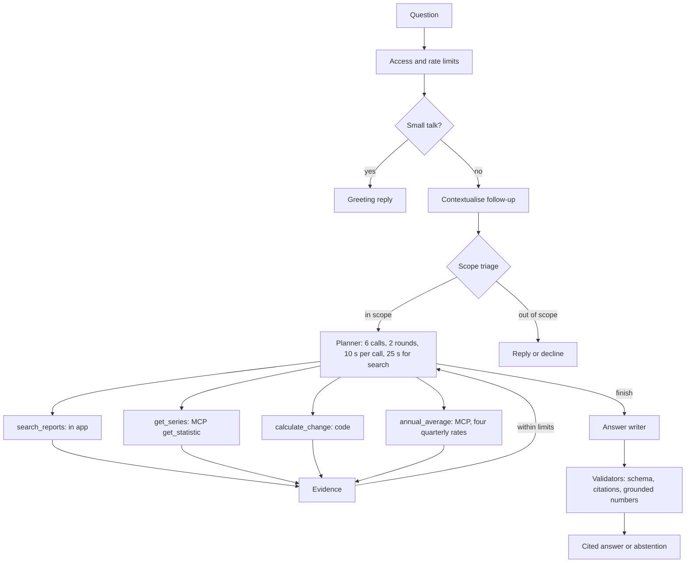
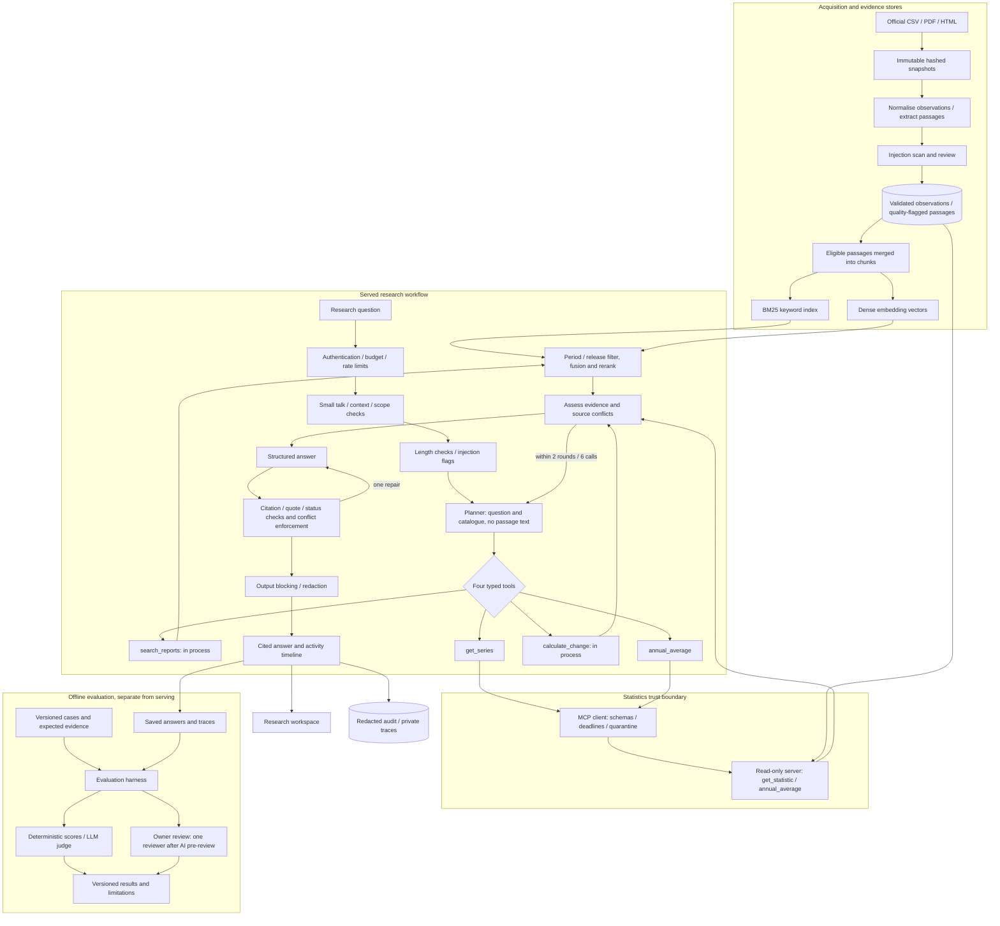

# LabourLens architecture

## Simple view

The whole system in one picture, then the path one question takes through the agent.

## 1. Overview

LabourLens answers Singapore labour-market research questions using official statistics and reports. It retrieves evidence, calculates numerical changes in code and returns an answer with citations, or explains why it cannot answer. The supported period is 2020-Q1 to 2026-Q2. The current local corpus is v4: 142 sources, 52,020 observations, 29,760 passages and 3,632 search chunks. A local build is not proof of deployment; check the deployed `/healthz` fingerprint and the [deployment record](deploy.md).

The served system differs from the evaluated one. Frozen final runs used corpus v3.1, the 2024-Q1 to 2026-Q2 scope, three tools and a structured-output planner, without the web context stages or MCP. Current serving uses four tools, native function calling and prompts `planner_v7`, `answer_v9`, `triage_v4` and `contextualise_v3`. The current prompts, added annual-average tool and v4 corpus have not had a new end-to-end evaluation. Earlier results do not measure this configuration.

The sections below describe the current design. [Architecture detail](reference/architecture-detail.md) preserves corpus history, route comparisons, implementation detail and decision-log references. Source rights and quality checks are in the [data sheet](data-sheet.md); measured results are in the [evaluation report](evaluation-report.md).

## 2. Component diagram

Rendered image ([Graphviz source](img/architecture.dot)):

The same components as Mermaid:

## 3. Data flow from ingestion to cited answer

1. **Acquire and check sources.** Download the specified CSV, PDF and HTML files, keep immutable snapshots and record hashes, dates and rights. Normalise statistics into Parquet rows with units, population, adjustment and raw-cell provenance. Report failed data contracts rather than serving failed datasets.
2. **Prepare report evidence.** Extract passages with page or section locators and quality flags. Merge adjacent eligible passages from one source and section into roughly 200-word chunks. BM25 keyword search and `text-embedding-3-large` vectors index the same chunks. Embeddings are built separately, never at server startup.
3. **Prepare the question.** Apply access and rate limits. Handle small talk without a model. Rewrite follow-ups using at most three earlier turns, then check scope. History is untrusted data; a failed rewrite uses the original question.
4. **Plan and collect evidence.** The planner sees the question and catalogue, not passage text. It chooses `search_reports`, `get_series`, `calculate_change` or `annual_average`. Search combines keyword and vector candidates, filters by period and release, then reranks. Statistics lookup and annual averaging cross MCP; search and change calculation stay in process. Calls within a round run in parallel. No retrieval happens before the loop.
5. **Calculate in code.** Changes use Decimal arithmetic on returned observations. Annual averaging requires four non-null quarterly percentage rates from one consistent series, rounds half up to two decimal places and records the input observation IDs. Missing quarters or mixed series return errors, never a partial average. The result is a derived simple mean, not an official annual rate.
6. **Write and validate.** The answer model receives bounded evidence and returns structured claims with citations. Checks cover schema, citation labels, verbatim evidence quotes, quote length, quality flags and answer status. Numbers absent from cited text are flagged, not proved correct by citation presence. Source conflicts are checked against validated statistics. One repair is allowed; remaining publisher-text overlap is removed with a copyright note.
7. **Return and record.** Block known secrets or system-prompt text, then show the answer, evidence and tool timeline. Streaming sends activity events, not model tokens: the answer appears only after validation. Record redacted audit metadata and private traces.

## 4. The agent graph

One LangGraph `StateGraph` in `src/labourlens/agent/graph.py` has seven nodes:

| Node | Work |
|---|---|
| `validate_question` | Reject empty or overlong input; record injection flags. |
| `plan_research` | Choose up to three typed calls, or finish. Invalid calls consume the budget. |
| `execute_tool` | Run calls in isolated worker threads with deadlines. |
| `assess_evidence` | Count evidence, note failures and annotate source conflicts. |
| `generate_answer` | Write structured claims from collected evidence. |
| `validate_answer` | Check citations and status; enforce supported dataset/report conflict corrections while preserving advance and preliminary vintages. |
| `finalize` | Apply the output guard and set the outcome. |

| Bound | Value |
|---|---|
| Evidence-gathering rounds (`MAX_ROUNDS`) | 2 |
| Tool calls | 6 per run, at most 3 per round |
| Tool deadline | 10 s; served `search_reports` gets 25 s |
| Search timeout retry | Once, up to 12 s, only when enough run time remains for the answer |
| Transient tool failure retry | Once, after the worker has finished |
| Malformed planner output retry | Once in historical structured-output mode; malformed native calls become budgeted `invalid_arguments` errors |
| Answer repair | Once |
| Graph recursion backstop | 40 |
| Question length | 1,000 characters |

Counters, decisions and activity events live in graph state. Evidence text stays in a separate per-run registry; checkpoints are in memory only. Timed-out workers cannot commit evidence. An exhausted tool or planner failure is `operational_failure`, not a claim that data is missing. Other outcomes are `answered`, `abstained`, `clarify`, `refused`, `invalid`, `rejected_input` and `blocked_output`.

## 5. MCP trust boundary

MCP is the protocol between the app's statistics client and a read-only server. The served agent maps `get_series` to server tool `get_statistic` and sends `annual_average` under its own name. The server has ten tools, two source-catalogue resources and one prompt, but the planner still has only its four fixed choices. The default server does not serve report text.

The client treats even a local server as untrusted. It checks the launch command, server identity, allowed tools, schemas, response sizes and deadlines, then validates typed results and quarantines instruction-like content. Screening is heuristic, not proof of safety, and resources need separate assessment. Secrets are redacted; the subprocess receives a minimal environment. Stdio is the default transport; optional HTTP is loopback-only with a bearer token.

Timeouts, crashes and malformed replies return typed errors or operational failures. There is no silent direct fallback. The optional report-serving profile, non-live all-tools route and measured comparisons are documented in the [detail reference](reference/architecture-detail.md#5-mcp-trust-boundary). The hostile `mcp/evil.py` server is a test fixture, never an allowed server. See the [threat model](threat-model.md).

## 6. Audit log

`src/labourlens/audit/log.py` writes daily run and event JSONL files plus feedback under local `data/audit/`. Records include redacted questions, salted session/client hashes, model and prompt versions, commit and manifest hashes, tool outcomes, guards, evidence IDs, usage, cost and latency. Raw IP addresses are not stored; a failed log write does not break a request.

The web runner also saves private run traces under `data/runs/agent/`, including cited quotes. Full retrieved text needs `LABOURLENS_DEBUG_EVIDENCE=true`. Redaction neither anonymises questions nor grants redistribution rights, so these files are not public demo material. Use `uv run labourlens audit-report`, `audit-show <run_id>` and `audit-prune --days N`; see [audit and logging](audit-and-logging.md) for fields and retention.

Offline evaluation reads saved runs rather than changing live answers. Development questions support configuration selection; original and fresh test questions must not tune prompts or labels. Automated scores do not replace human review.

## 7. Module map

Paths below are relative to `src/labourlens/` unless stated otherwise. The [full module map](reference/architecture-detail.md#7-module-map) lists individual files.

| Area | Path | Purpose |
|---|---|---|
| Commands and shared records | `cli.py`, `paths.py`, `models.py`, `prices.py` | Commands, directories, record types and costs |
| Source definitions | Repository `specs/` | Source inventory, dataset mappings and prices |
| Ingestion and analysis | `data/` | Acquisition, hashes, normalisation, contracts, parsing, provenance and EDA |
| Retrieval | `retrieval/` | Chunks, keyword/vector search, filtering, caching, reranking and retrieval experiments |
| Agent | `agent/` | Graph, tools, served configuration, context rewriting and triage |
| Answers | `answer/` | Schema, context, model calls, validation and source cross-checks |
| MCP | `mcp/` | Server, client, deterministic analysis, transports, redaction and fixtures |
| Safety and audit | `security/`, `audit/` | Guards, threat cases and local logs |
| Evaluation | `evaluation/`; repository `experiments/` | Scoring, cases, configurations and saved runs |
| Web | `report/`; repository `web/` | FastAPI, report/deck and research workbench |
| Prompts and tests | Repository `prompts/`, `tests/` | Versioned prompts and data, retrieval, agent, MCP, web and safety tests |

## 8. Key design decisions

| Choice | Why |
|---|---|
| Immutable snapshots and traceable observations | A numerical claim must lead back to its source cell and definition. |
| Report PDFs and extracted text stay local | Public packaging must respect publisher rights. |
| JSONL passages, Parquet observations and disk indexes | The corpus fits local files; no database server is needed. |
| Shared chunks and corpus-fingerprint checks | Retrieval methods use comparable evidence; stale indexes cannot silently serve old text. |
| One bounded agent with four typed tools | Keep tool choice and failure handling inspectable. |
| No passage text in the planner | Retrieved instructions cannot directly steer tool selection. |
| Deterministic arithmetic and claim-level citations | Separate calculation from prose and make claims checkable. |
| Abstention and operational failure are distinct | Missing evidence is not the same as a broken tool. |
| Statistics-only MCP route by default | Keep report search and change calculation in process while validating the protocol boundary. |
| Frozen experiments kept separate from serving | Preserve null results and avoid presenting untested changes as measured improvements. |

Alternatives, historical measurements and decision-log entries remain in the [detailed decision table](reference/architecture-detail.md#8-key-design-decisions) and [decision log](decisions.md).
