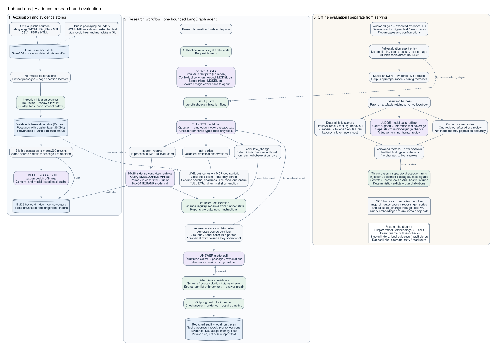
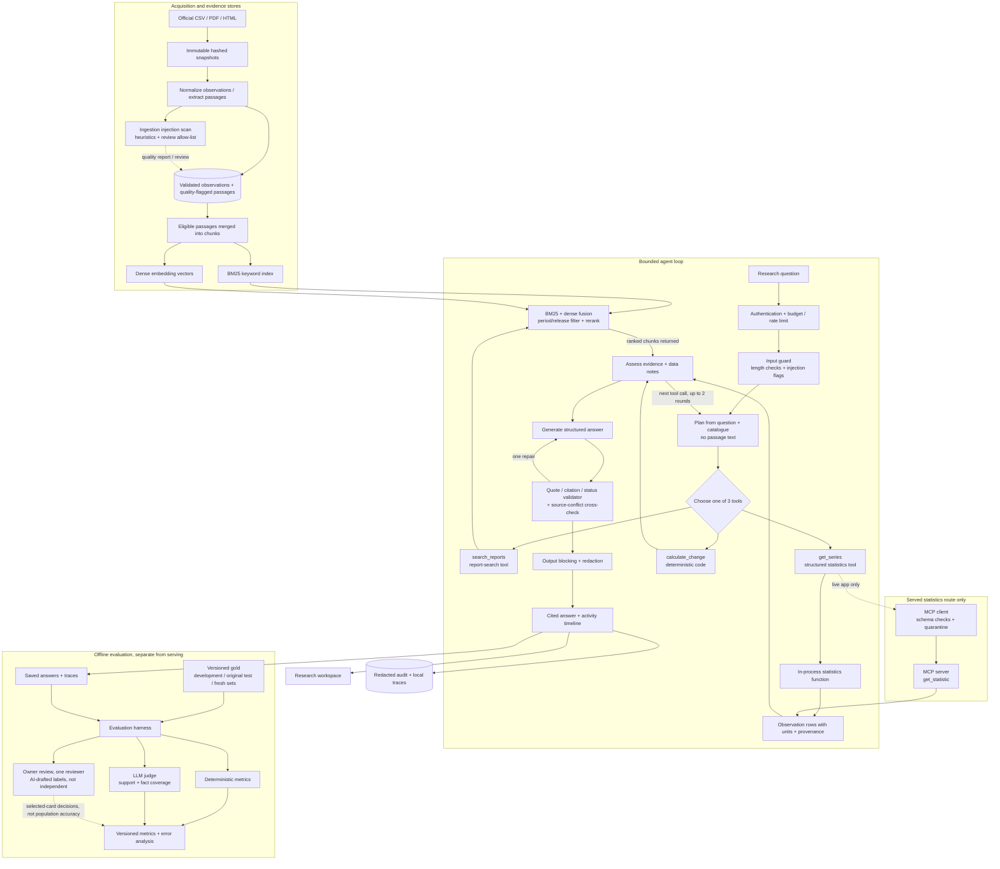

# LabourLens architecture

This document describes the system as built on 1 November 2026. Decision ids (D-nnn) refer to `docs/decisions.md`. Evaluation results are not in this document. See the evaluation report (`docs/evaluation-report.md`), the deck at `/deck` and `experiments/eval/`.

## 1. Overview

LabourLens answers questions from Singapore policy researchers about labour-market statistics and MOM reports. The supported period is 2024-Q1 to 2026-Q2 (ADR-001, `docs/decisions/ADR-001-scope.md`).

Two kinds of source feed the system.

- **Structured data.** Quarterly datasets from data.gov.sg, published by MOM and SingStat. They are fetched as immutable snapshots, normalised into one observation table and checked by data contracts (ADR-003, D-003).
- **Reports.** MOM labour-market reports and advance releases. They are parsed into passages with page or section locators. The PDFs are all-rights-reserved, so they and their text stay out of Git (D-001).

One bounded LangGraph agent chooses among exactly three read-only tools inside its loop: `search_reports` retrieves report chunks, `get_series` returns structured statistical observations, and `calculate_change` performs deterministic arithmetic. Search is not run before the agent. In the live app, only `get_series` crosses the MCP client to server tool `get_statistic`; report search and calculation stay in process. The planner sees the question and a catalogue, never passage text. A deterministic validator checks every answer before it is returned. The answer has one of four statuses: answered, abstained, clarify or refused (D-024).

The README (`README.md`) states the current data counts. The data sheet (`docs/data-sheet.md`) records sources, licences and checks.

**Served versus evaluated.** The live web app adds two stages in front of the agent that the diagram's core path does not include: a **small-talk fast path** (D-050, whole-message greetings answered with no model call) and a **model scope check** (D-051, one `gpt-6-luna` call that can answer or decline off-topic, small-talk and unsafe messages without the agent; it fails open to the agent on error). The evaluated entry points (`run_agent`, `agent-exp`, `threat-test`) do not use them. Differences between served and evaluated are the D-043 runtime changes, D-050, D-051 and D-053 (the served app routes `get_series` through the local MCP stdio server; full-set FIN/FIN2 calls statistics directly; D-058/D-061 measures the served MCP research chain on a 65-case sample, one run). The scope check was measured on its own (0 of 333 gold and held-out v2 questions diverted, 1 of 36 threat cases diverted, 30 of 30 off-topic messages caught; `experiments/triage/triage-v1-luna/metrics.json`); no end-to-end run exists with it on.

**Conversation context (D-054).** In the served app only, a rewrite stage (`agent/contextualise.py`, prompt `contextualise_v1`) sits ahead of the scope check: the browser sends at most three earlier turns, the server supplies today's date in Singapore time, and one `gpt-6-luna` call turns a follow-up or a relative-date message into one standalone question. It fails open to the original message, records both texts in the audit record and shows "Read as: ..." when they differ. Small talk is decided on the original message with no history. `run_agent` and the evaluated entry points never use it, so no evaluated result describes this stage.

**Corpus versions.** Three corpus states exist. **v1** (13,484 passages) is what every registered held-out and development experiment (A1 to A5, H-r3, H-hybrid) ran on. **v2** (`extract-0.2`, D-037/D-041: 15,915 passages, 1,732 `merge200` chunks, 43,662 observations) was used for the extraction-only X1 runs and the first post-fix T-I06 run. **v3** (v2 plus six labour-only sources, D-040) is what the committed manifest and quality report and the local store hold: 85 sources (36 datasets, 49 documents), 52,020 observations (4,300 in the answer scope), 16,419 passages, 1,847 chunks, 276 build checks (269 pass, 7 warn). Three measured evaluations exist on v3, all on 31 Oct 2026: the X2 development regression check, the `m7-e2efix-20261031` threat run (`docs/experiments/m7-e2e-fixes.md`) and held-out v2, the first evidence-disjoint-source evaluation (`docs/experiments/m7-heldout-v2-result.md`, D-045). Serving: the live site serves corpus v3.1 (16,419 passages, 1,847 chunks); `/healthz` shows the commit and the corpus fingerprint (content fingerprint `242e2b284fbc` when last checked on 1 Nov 2026).

**v3.1** (`extract-0.3`, D-052) is the current local build: same sources, passages and chunk count as v3, with 40 MTI passages relabelled by a refined garbled-text rule; current-corpus evidence now includes FIN/FIN2, tagged V31 retrieval, the served-chain sample and fresh 2 Nov threats, beside the earlier D-055 re-run.

The v2 extraction rebuild was byte-identical across two offline builds. PDF parsing uses page-local layout headings, control detection, footer provenance and explicit context-required fragments; HTML parsing stays article-bounded. Context deduplication is limited to identical normalised text within one source snapshot. Gold v3.6 migrates evidence IDs only. The premerge code tag is `corpus-v1-frozen`; private premerge stores are retained separately. Dense embeddings are content- and model-keyed, so unchanged inputs reuse cached vectors even when passage IDs move. See `docs/experiments/m7-corpus-v2-runbook.md` and `docs/experiments/m7-corpus-v3-runbook.md`.

## 2. Component diagram

Rendered image (Graphviz, source `img/architecture.dot`): 

The same diagram as Mermaid, for viewers that render it:

## 3. Data flow from ingestion to cited answer

1. **Fetch.** `src/labourlens/data/fetch.py` and `acquire.py` download each source named in `specs/sources.yaml` and `specs/sources.d/`. `raw_store.py` writes the file under a snapshot id with its SHA-256 hash. Dataset snapshots are committed in `data/snapshots/`. MOM files go to `data/raw/`, which is gitignored.
2. **Normalise.** `data/normalize.py` reads each dataset using its spec in `specs/datasets/*.yaml` and writes one long table, `data/processed/observations.parquet`. Every row keeps indicator, population, seasonal adjustment, unit, release stage and an observation id that leads back to the raw cell (`labourlens trace <id>`).
3. **Validate.** `data/validate.py` runs the data contracts and writes `artifacts/data-quality/quality-report.md`. A dataset that fails its contract is dropped and reported (D-005).
4. **Extract.** `pdf_extract.py` and `html_extract.py` split reports into passages. Each passage has an id, a page or section locator and a quality flag. Output is `data/passages/*.jsonl`.
5. **Chunk and index.** `retrieval/chunk.py` merges adjacent `ok` passages within one source and section into `merge200` chunks, targeting about 200 words with up to 40 words of whole-passage overlap. Corpus v3.1 has 16,419 passages and 1,847 chunks. BM25 and text-embedding-3-large vectors index the same chunks. The embedding cache is local and content-keyed; per-build index and corpus metadata identify which chunks the cache represents.
6. **Plan.** The planner receives the question and dataset catalogue, never passage text. It chooses one of exactly three fixed tools; it does not retrieve a pack before the agent loop. After each call, returned chunks or rows become evidence for the next decision.
7. **Execute one tool inside the loop.** `search_reports` runs hybrid BM25+dense retrieval, period/release filtering and reranking, then returns report chunks. `get_series` returns structured observations; in the live app only, the MCP client calls server tool `get_statistic` over stdio with source, period range and dimension, then returns validated rows. The full final evaluations call the same statistics functions directly. `calculate_change` performs Decimal arithmetic on observation rows already returned. All three tool results return to the agent's evidence check.
8. **Answer.** `answer/context.py` renders items and notes into the prompt. The model returns a structured answer with claim-level citations, each with a verbatim quote (`answer/schema.py`).
9. **Validate.** `answer/validate.py` rejects an answer when a cited label is not in the context, a quote is not verbatim in the cited item, a quote exceeds 40 words, a flagged item is cited or the status contradicts the content. One repair attempt follows. Numbers in a claim that do not appear in the cited text are reported as ungrounded.
10. **Finalize.** The output guard in `security/guards.py` blocks answers that contain a known secret or system-prompt text. The page shows the answer, the evidence behind each citation and the tool timeline.

### Browser pages and public API

`GET /` serves `web/index.html` for the report/presentation; `GET /workbench` and `GET /workbench.html` both serve `web/workbench.html`. These static pages are public even when live research is disabled. All use the same security-header middleware, self-hosted assets and CSP (`script-src 'self'; style-src 'self'`); opening a page does not invoke research.

The workbench uses the existing authenticated `POST /api/ask`, session/status and feedback endpoints, not a new retrieval or audit endpoint. Its public result projects observation values and definition fields (`unit`, `indicator_id`, `population`, `adjustment`, `dimension`, `period`, plus available `missing_reason` and `source_locator`) only from stored observation records. Non-finite observation values become `null`. Optional `usage.prompt_tokens` and `usage.completion_tokens` come from recorded usage, not estimates. Calculation cards identify derived evidence as `calculated`, omit the dataset publication date and use input labels/periods only when present in deterministic calculation text; their source URL still identifies the underlying dataset. Calculation values/units are not guessed. Report text remains limited to bounded, verified cited quotes; full passages, hidden reasoning and private audit records are not exposed.

## 4. The agent graph

Built in `src/labourlens/agent/graph.py` with LangGraph `StateGraph` (ADR-002, D-027). There is one agent with seven nodes.

| Node | Work |
|---|---|
| `validate_question` | Rejects an empty question or one over 1,000 characters. Records heuristic injection flags. |
| `plan_research` | Planner model proposes up to three tool calls, or decides to finish. |
| `execute_tool` | Runs each call in a worker thread with a timeout. |
| `assess_evidence` | Counts passages, observations and calculations. Reports an operational failure if every tool call failed. Annotates conflicts between a passage figure and the validated dataset value for the same indicator and period (`answer/crosscheck.py`, D-038). |
| `generate_answer` | Answer model writes the structured answer from the evidence. |
| `validate_answer` | Runs the checks in section 3, step 9, and enforces the source-conflict cross-check: a used conflicting level is replaced by the dataset figure with both citations and a caveat. Closed grammar of phrasings; advance and preliminary vintages are preserved. |
| `finalize` | Applies the output guard and sets the outcome. |

Bounds, all constants or fields in `graph.py`:

| Bound | Value |
|---|---|
| Evidence-gathering rounds | 2 |
| Tool calls per run | 6, at most 3 per round |
| Time per tool call | 10 s |
| Retry for a transient tool failure | 1 |
| Retry for malformed planner output | 1 |
| Repair of an invalid answer | 1 |
| Graph recursion backstop | 40 |
| Question length | 1,000 characters |

Graph state holds counters, decisions and the activity trace. Evidence text sits in a per-run registry, not in graph state (ADR-002, item 3). Checkpointing is in memory only (D-027).

Outcomes are `answered`, `abstained`, `clarify`, `refused`, `invalid`, `rejected_input`, `blocked_output` and `operational_failure`. A tool outage, a timeout or a planner outage ends in `operational_failure`. It is never reported as missing evidence. Tests for these paths are in `tests/retrieval/test_agent.py`.

## 5. MCP trust boundary

The server is `src/labourlens/mcp/server.py`, built on the official `mcp` SDK. It offers nine read-only tools, two resources (`labourlens://sources` and `labourlens://source/{id}`) and one prompt. It serves statistics and catalogue metadata. It never serves MOM text (D-028). The default transport is stdio. An optional loopback HTTP transport with a bearer token is in `mcp/http_server.py`.

The client is `src/labourlens/mcp/client.py`. It treats the server as untrusted: allow-listed launch, minimal subprocess environment, name/version checks, tool allow-list, input schemas, deadlines, response-size caps, typed tool-result validation and instruction-like-content quarantine. `mcp/redact.py` redacts secrets. The diagram names controls, not proof that every hostile paraphrase is detected; the saved transcript includes a heuristic miss. Resource handling must be assessed separately from tool-result screening. See `docs/threat-model.md`.

The served web app sets `Shared.stats_backend` to a `SyncStatsBackend`, so the agent's `get_series` is an MCP `get_statistic` call to the local `labourlens-stats` stdio server, and its trace event carries `transport: "mcp"` (D-053; `LABOURLENS_MCP=false` or `Settings.mcp_enabled` off returns to direct calls). `search_reports` and `calculate_change` stay in-process, and the other eight tools are not given to the agent. The evaluated entry points (`run_agent`, `agent-exp`, `threat-test`) leave `stats_backend` unset and call statistics directly, so full-set FIN/FIN2 accuracy does not describe that route; D-058/D-061 now measures the actual served research chain on a 65-case sample (51 development gold + 14 probes), 90.8% both models with no observed loss against direct/web-on, one run and not independent evaluation. `docs/mcp-demo-transcript.md` records a session of real calls in a fixed order (2 Nov 2026) and a direct-versus-MCP comparison in section 17 (median 36.1 ms against 4.5 ms per call, 1.84 s one-off connect).

`src/labourlens/mcp/evil.py` is a test fixture. It is a deliberately hostile server and is never on the allow-list.

## 6. Audit log

`src/labourlens/audit/log.py` appends run records to `data/audit/runs-YYYY-MM-DD.jsonl`, feedback to `feedback.jsonl`, and administrative/rejection events to `events-YYYY-MM-DD.jsonl`. With trace saving enabled, `data/runs/agent/<run_id>.json` also contains the detailed run: evidence ids, hashes and the answer's cited quotes. Full retrieved evidence text is stored only when the debug flag `LABOURLENS_DEBUG_EVIDENCE=true` is set. The web runner currently enables trace saving (`src/labourlens/report/app.py`). Those local files are not safe public presentation artifacts; redaction does not confer MOM redistribution rights or anonymise user questions.

A record holds the run id, channel, salted hashes of session and client, the redacted question, model and prompt versions, git commit, data manifest hash, outcome, tool calls with outcomes, guard events, data-quality notes, evidence and cited ids, token usage, cost and latency. Secrets are redacted before every write. Raw IP addresses are not stored. A write failure never breaks a request.

Commands: `uv run labourlens audit-report`, `audit-show <run_id>` and `audit-prune --days N`. Field-level detail is in `docs/audit-and-logging.md`. The `data/audit/` directory is local and not published.

The evaluation branch consumes saved runs rather than changing live answers. Development cases support configuration selection; held-out cases must not tune prompts or labels. Deterministic scoring checks behavior, evidence IDs and numbers; the LLM judge estimates semantic support and reference-fact coverage. Neither substitutes for the prepared human review sheets. No completed human review or held-out outcome is asserted by this diagram.

## 7. Module map

| Area | Path | Purpose |
|---|---|---|
| CLI | `src/labourlens/cli.py` | All commands: fetch, build, eda, export, serve, agent-exp, threat-test, eval, audit-* |
| Paths and models | `src/labourlens/paths.py`, `models.py` | Directory layout, shared record types |
| Source specs | `specs/sources.yaml`, `specs/sources.d/`, `specs/datasets/` | What to fetch and how each dataset is read |
| Prices | `specs/prices.yaml`, `src/labourlens/prices.py` | Model price table used for cost per case |
| Acquisition | `src/labourlens/data/fetch.py`, `acquire.py`, `raw_store.py`, `catalog.py` | Download, hash and catalogue sources |
| Normalisation | `src/labourlens/data/normalize.py`, `validate.py`, `build.py` | Observation table and data contracts |
| Report parsing | `src/labourlens/data/pdf_extract.py`, `html_extract.py` | Passages with locators |
| Analytics | `src/labourlens/data/reconcile.py`, `derived.py`, `revisions.py`, `eda.py`, `export.py`, `trace.py`, `review.py` | Advance-versus-final reconciliation, derived checks, revision tracker, figures, provenance, review sheets |
| Retrieval | `src/labourlens/retrieval/chunk.py`, `tokenize.py`, `bm25_index.py`, `dense.py`, `runtime.py` | Chunking, BM25, dense and hybrid search |
| Retrieval evaluation | `src/labourlens/retrieval/gold.py`, `evaluate.py`, `experiments.py`, `experiments_dense.py` | Gold-set validator, retrieval metrics, experiment runners |
| Answers | `src/labourlens/answer/schema.py`, `context.py`, `llm.py`, `pipeline.py`, `validate.py`, `experiments.py` | Answer schema, prompt context, model client, validator |
| Agent | `src/labourlens/agent/graph.py`, `tools.py`, `experiments.py` | LangGraph graph, tools, experiment runner; `search_reports` defaults to `r3` (D-030): quarter and release filter on both candidate lists, then a top-30 LLM rerank; `hybrid` (earlier default) and `r3w` (widening when the filtered pool is small) remain selectable; search traces/audit and run usage include rerank metadata/cost |
| MCP | `src/labourlens/mcp/server.py`, `analysis.py`, `models.py`, `client.py`, `http_server.py`, `redact.py`, `demo.py`, `evil.py` | Server, client, real-call fixed-order recording, hostile fixture |
| Security | `src/labourlens/security/guards.py`, `threat_suite.py` | Injection and output guards, adversarial suite |
| Evaluation | `src/labourlens/evaluation/harness.py` | Metrics from saved raw runs |
| Audit | `src/labourlens/audit/log.py` | Run, feedback and event logs |
| Web | `src/labourlens/report/app.py`, `serve.py`, `build.py`, `audit.py`; `web/index.html`, `web/workbench.html`, `web/static/` | FastAPI server and report builder; report/presentation page plus a separate research workbench, self-hosted fonts and no inline script or style |
| Prompts | `prompts/planner_v1.md`, `answer_v1.md` to `answer_v4.md`, `answer_naive.md`, `repair_v1.md`, `judge_v1.md` | Versioned prompts with matching `_user.md` templates |
| Tests | `tests/data/`, `tests/retrieval/`, `tests/mcp/`, `tests/web/`, `tests/test_security.py`, `tests/test_audit_and_notes.py` | Unit, integration, protocol and adversarial tests |
| Gold set | `experiments/gold/draft_cases.jsonl`, `CHANGELOG.md`, `ai-review/`, `ai-review-2/` | Evaluation cases and their review history |
| Experiments | `experiments/eval/`, `experiments/runs/`, `experiments/threats/`, `docs/experiments/` | Raw and summarised experiment outputs |

## 8. Key design decisions

| Decision | Reason | Id |
|---|---|---|
| MOM PDFs and their text stay out of Git | The notices reserve all rights. | D-001 |
| Report page as the presentation | Reviewers can open any number and its source. | D-010 |
| Passages as JSONL, indexes on disk, no database server | The corpus is small and the files are easy to audit. | D-009 |
| BM25 index persisted with a corpus hash that fails on mismatch | A stale index must not serve old text. | D-012 |
| Chunks of about 200 words from adjacent good passages | The median passage is too short to retrieve on its own. | D-015 |
| Compare options under a fixed harness and report null results | Choices should rest on measurements. | D-016 |
| Gold cases labelled at passage and observation level | Every chunking variant can be scored. | D-017 |
| Hosted OpenAI embeddings and models, chosen by experiment | Candidates are compared on our own cases and costs. | D-021, D-022 |
| Claim-level citations with verbatim quotes | A reviewer can check each claim against its quote. | D-024 |
| Prefer declining to a wrong answer | A wrong figure does more harm in policy work than a decline. | D-026 |
| One bounded agent, three typed tools, enum-constrained planner | Fewer moving parts and a measurable failure surface. | ADR-002, D-027 |
| Code computes every difference and percentage | The model is not trusted with arithmetic. | D-027 |
| Planner never sees passage text | Injected text cannot steer tool choice. | D-027, D-028 |
| Operational failures end the run and are never "no data" | A tool outage must not look like an absence of evidence. | ADR-002, D-028 |
| MCP server with nine read-only tools and a screening client | The server is treated as untrusted even when local. | D-028 |
| Served app uses MCP for `get_series`; full-set FIN/FIN2 statistics calls stay direct | The live app exercises the protocol end to end; it adds a typed interface, latency and an operational failure mode. D-058/D-061 measured the served chain on one 65-case sample: no observed accuracy loss against direct, but no demonstrated gain, full-set evaluation or equivalence. Switch back with `LABOURLENS_MCP=false`. | D-028, D-053, D-058, D-061 |
| Structured data scope of 36 datasets through a spec-driven adapter (33 until corpus v3) | One adapter and a spec per dataset keep the cost of each addition low. | ADR-003, D-003, D-040 |
| Labels follow what the evidence supports | One rule makes abstain, refuse and answer cases consistent. | `experiments/gold/CHANGELOG.md`, section v3 |
