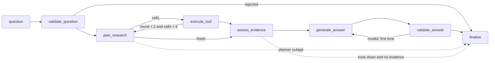

# M4: bounded LangGraph research agent (dev split)

Status: dev only, nothing locked, held-out untouched. Gold labels are AI drafts, not reviewed by the owner. 34 dev cases (all families, including the 6 numerical ones that needed the statistics tool). One run per configuration; the same prompts gave different rates across runs in M3, so differences under about 10 points are noise.

Code: `src/labourlens/agent/` (`tools.py`, `graph.py`, `experiments.py`); prompts `prompts/planner_v1*.md`, `prompts/answer_v2*.md`; run `uv run labourlens agent-exp --split dev`. Tests: `tests/retrieval/test_agent.py` (13, including fault injection). Decision: D-027.

## Design

Tools (read-only, typed, validated; the approved three): `search_reports` (hybrid retrieval over MOM text), `get_series` (published observations with provenance, 2024-Q1 to 2026-Q2 only), `calculate_change` (exact Decimal arithmetic; accepts only observation labels that `get_series` returned in the same run, same series only, percentage-point units for rates).

Bounds: 2 evidence rounds, 6 tool calls (3 per round), 10 s per tool call, one retry for a transient tool failure or malformed planner output, one repair of an invalid answer. The planner sees evidence labels and sources, never passage text. Tool failure kinds are separated: invalid arguments and not-found are shown to the planner (it can correct once, in round 2); a timeout or crash after retry is an operational failure and produces `outcome: operational_failure`, never an "abstained" answer. State holds counters and a trace, not documents. Each run writes a trace to `data/runs/agent/` (local).

## Results: A1, model for planner and answer step (n=34)
| config | valid | behaviour | over-abstain | false-answer | numbers complete | calc correct (n=6) | gold cited | tool calls | tool-error rate | op. failures | p50 s | $ per case |
|---|---|---|---|---|---|---|---|---|---|---|---|---|
| gpt-6-luna | 1.00 | 0.71 | 0.21 | 0.17 | 0.61 | 0.67 | 0.65 | 1.9 | 0.00 | 0 | 13.2 | 0.0014 |
| gpt-5.6-luna | 0.97 | 0.77 | 0.18 | 0.17 | 0.68 | 0.67 | 0.68 | 2.1 | 0.00 | 0 | 10.8 | 0.0030 |
| gpt-4.1-mini | 0.94 | 0.82 | 0.14 | 0.33 | 0.61 | 0.50 | 0.52 | 2.0 | 0.29 | 0 | 5.8 | 0.0046 |

Per family (behaviour, gpt-6-luna): revision_conflict 1.00 (4 cases; M3 text-only scored 0.00 to 0.50 on these), cross_source 0.86 (7), adversarial 0.80 (5), numerical 0.67 (6), factual 0.62 (8), ambiguity 0.25 (4). The M3 comparison is indicative only: the case set grew from 30 to 34 and the prompt changed (answer_v2).

## What the data says (MEASURED, dev n=34)
1. **Tools fixed what retrieval could not.** Revision and cross-source questions, which failed in M3 because the figures live in datasets or need two documents, are now mostly answered. 4 of the 6 numerical cases are answered with an exact tool-calculated figure and the right figure cited.
2. **Remaining failures, by cause (gpt-6-luna, 10 of 34 behaviour misses):** (a) two numerical cases (DEV-031, DEV-032) need arithmetic on figures that appear only in report text; `calculate_change` accepts dataset observations only, so the model correctly abstains. Known gap, candidate improvement for M6. (b) The ambiguity family (1 of 4 correct) mixes label questions with model behaviour: DEV-016 (a forecast) is labelled abstain but "refused" is defensible; DEV-013 expects a clarifying question and the model abstained. These need your review of the labels. (c) Over-abstention on factual cases (DEV-003, 024, 026) where retrieval did not surface the passage.
3. **Constraining the planner schema mattered.** First run: gpt-4.1-mini produced 7 planner failures (it looped on a long made-up `indicator_id` until truncated) and 44% of cases had a tool error from invented source ids. After making source_id, indicator_id, adjustment and kind enums from the catalogue: 0 operational failures and 29% tool errors for that model, 0% for the luna models. The tools still validate everything; the enum only helps the model.
4. **Cost and latency.** $0.0014 to $0.0046 per case (planner plus answer, about 2 tool calls); p50 6 to 13 s. gpt-6-luna is the cheapest and slowest; gpt-4.1-mini the fastest but the most expensive here because it takes more tokens and has more false answers (0.33).
5. **gpt-6-luna remains the candidate default under D-026 (prefer declining):** 100% valid answers, 0 tool errors, cheapest, false-answer rate tied with gpt-5.6-luna at 0.17 (1 of 6). gpt-5.6-luna is a few points better on completeness at about 2x the cost.

## Limits
- One run per configuration, 34 draft-labelled cases; six numerical cases; six non-answer cases.
- Prompt injection inside tool results has not been tested yet (M5 threat tests); the planner never sees passage text, but the answer step does.
- Planner and answer step share one model per configuration; mixing models is untested.
- Latency includes OpenAI round trips and varies by load.
