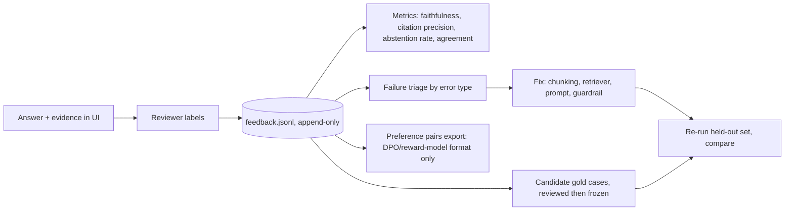

# Human feedback in the interface: design (PROPOSAL, owner decision D-011 pending)

**Status:** design only. Nothing here is built. UI work is M7; the feedback schema and the evaluation loop are built at M6. The M1 spot-check sheets (`docs/human-review/`) use the same idea on paper.

## Honest framing
**RLHF** in the strict sense means training a reward model from human preferences and then fine-tuning the language model against it. This project calls hosted API models whose weights we cannot change, and the assessment asks for evidence-based improvement, not training. So we do **not** claim RLHF. We build a **human-feedback loop**: capture structured human judgements in the interface, store them as data, and use them to (1) measure quality, (2) change retrieval, prompts and guardrails, and (3) grow the gold evaluation set. We also export the choices in preference-pair format so a reader can see how the same data would feed DPO or a reward model in a larger programme. That export is a data format, not a training run.

## What a reviewer can do on each answer
| Control | Captures | Stored field |
|---|---|---|
| Per-claim thumbs (supported / not supported / wrong number) | Faithfulness at claim level | `claim_id`, `verdict` |
| Per-citation check (right passage / wrong passage / irrelevant) | Citation precision | `citation_id`, `verdict` |
| Evidence missing (pick a passage or dataset that should have been used) | Retrieval recall gap | `missing_evidence_id` |
| Abstention judgement (should have answered / right to abstain / should have abstained) | Calibration | `abstention_verdict` |
| Error category (retrieval, data/definition, tool, reasoning, citation, safety) | Matches the evaluation taxonomy | `error_type` |
| Side-by-side preference between two configurations (blind, order randomised) | Preference pair | `chosen_run_id`, `rejected_run_id` |
| Free-text note | Context | `note` |

Every review row records `reviewer_id`, `timestamp`, `run_id` (config, prompt version, retrieval version, index snapshot), and `reviewer_kind` = `human` or `ai_judge`. AI judges are never stored as human. Reviewer ids are pseudonymous; no free text is sent to any model.

## How the feedback is used

1. **Metrics.** Aggregate by question family and error type; report inter-reviewer agreement (Cohen's kappa) when two people label the same items. Low agreement means the rubric is unclear, not that the model is bad.
2. **Triage to fixes.** Each error type maps to an owner component, for example 'missing evidence' to chunking or retriever, 'wrong number' to tool or data adapter, 'unsupported claim' to prompt or verifier.
3. **Gold set growth with a firewall.** Reviewer-flagged failures become candidate cases in a development split. The held-out split is frozen before any tuning (CLAUDE.md rule); feedback never edits it.
4. **Change log.** Every change made because of feedback cites the feedback row ids, so improvement claims are traceable.
5. **Preference export.** Pairs `(prompt, chosen, rejected)` are written to `experiments/preferences.jsonl` with the run metadata, for transparency about how it would feed DPO or a reward model. No training is performed.

## Risks and controls
- Reviewer bias and small sample: report counts and agreement, never claim statistical power we lack.
- Position bias in side-by-side: randomise order, log the order.
- Feedback poisoning in a hosted demo: feedback is write-only, rate-limited, authenticated against the allow-list, stored separately from the gold set, and never executed or injected into prompts.
- Privacy: no personal data collected beyond a pseudonymous reviewer id.

## Where it shows in the interactive report page
Section 6 (how it was tested) shows aggregate review results and agreement. Section 5 (ask the assistant) carries the feedback controls so visiting reviewers can try the loop themselves. Their entries go to a separate demo-feedback store and are labelled as demo data in the report, not counted in the evaluation.

## Open question for the owner
See D-011.
